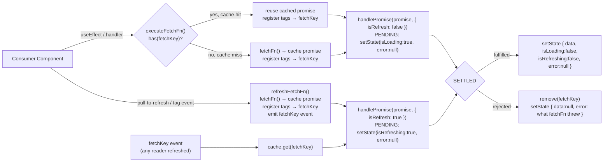
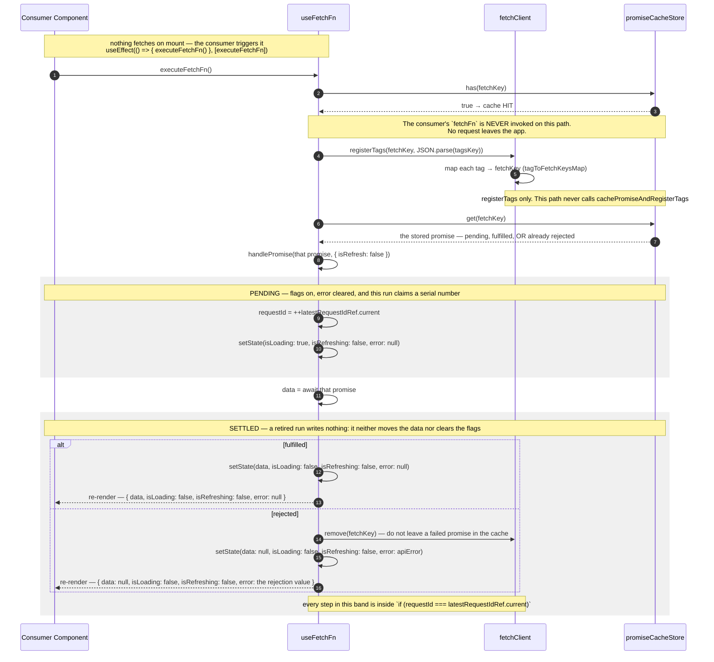
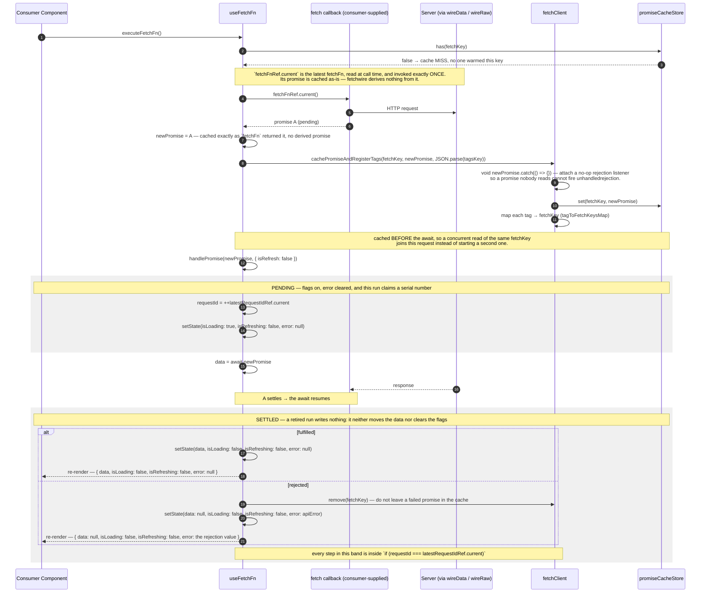
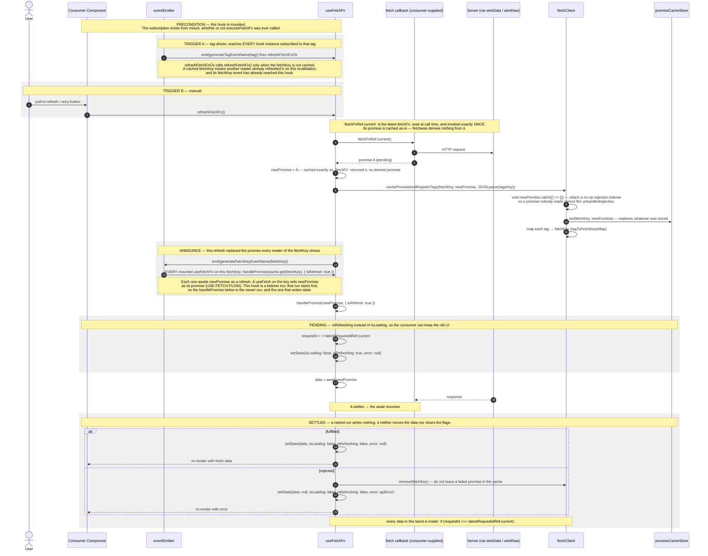

# useFetchFn — Imperative Data Flow

The **imperative** fetch hook: it exposes plain state — `data`, `isLoading`, `isRefreshing`, `error` — and a
function for us to call ourselves.

> **The one idea that defines this flow.** `useFetchFn` does **not** suspend and does **not** throw to an
> `ErrorBoundary`. It models the promise's whole lifecycle — **pending → fulfilled | rejected** — as three
> shapes of local `useState` (`isLoading`/`isRefreshing`, `data`, `error`). Use this when we want manual
> control instead of Suspense.

> Every path below ends in _one_ function, `handlePromise(promise, { isRefresh })`
> ([use-fetch-fn.ts](../../src/react/use-fetch-fn.ts)): it sets the flags, awaits the promise, and writes
> `data` or `error`. The three entry points differ only in where the promise comes from:
>
> | Entry | The promise | `isRefresh` (which flag) |
> | --- | --- | --- |
> | `executeFetchFn()` | the cached promise of `fetchKey`, or `fetchFn()` cached when none is | `false` → `isLoading` |
> | `refreshFetchFn()` | `fetchFn()`, cached, then the fetchKey event emitted | `true` → `isRefreshing` |
> | the fetchKey event, any reader refreshed | the promise that refresh cached | `true` → `isRefreshing` |

---

## Where it fits

Read the map as three bands: the entry point picks a **promise**, then **PENDING** (flags on, a serial
number claimed), then **SETTLED** (`fulfilled` / `rejected`). Every path ends in the same two bands — that
symmetry is what the sequence diagrams below preserve.

Unlike `useFetch`, there is **no** `<Suspense>`/`<ErrorBoundary>` in the picture — every branch ends in
state the consumer reads.

---

## executeFetchFn — Cache hit

Reached when the `fetchKey` is already in the Promise cache. That warmth does not have to come from
[`prefetch`](./PREFETCH-FLOW.md): a previous `executeFetchFn`, a `refreshFetchFn`, or a mounted
[`useFetch`](./USE-FETCH-FLOW.md) on the same key all write the same store.

The practical consequence: **a second `executeFetchFn()` returns the first call's data without touching the
network.** When we need fresh data, call `refreshFetchFn()`.

---

## executeFetchFn — Cache miss

The default path when nothing warmed the key. The hook fires the request itself and caches the in-flight
promise **before** awaiting it.

---

## Refresh — tag-driven & manual

A refresh never reads the cache. It always issues a request, always overwrites the cache entry, and emits
the fetchKey event, so every mounted `useFetch` and `useFetchFn` on the `fetchKey` shows the new promise.
The event names are explained in [USE-FETCH-FLOW](./USE-FETCH-FLOW.md#refresh--tag-driven--manual).

> **Why refresh writes `isRefreshing`, not `isLoading`.** The two flags let the consumer distinguish the
> _first_ load (skeleton) from a _background_ refresh (keep old UI, show a spinner). `isLoading` is set
> only when `isRefresh` is false.

> **Why only the newest run writes state.** Two `handlePromise` runs can overlap, for example a
> pull-to-refresh that starts while the first load is still in flight, and their responses can arrive in
> either order. Each run takes a number when it starts (`++latestRequestIdRef.current`) and writes state
> only if no later run has started since. So the hook shows the response of the request started last,
> even when an older response arrives after it.

> **Why `tagsKey = JSON.stringify(tags)`.** `options.tags` is a new array on every render. Here the
> serialized string does double duty: it keeps the subscription `useEffect` from re-running each render,
> **and** it is a dependency of the `useCallback`s that memoize `executeFetchFn` and `refreshFetchFn` —
> without a stable primitive, `executeFetchFn` would change identity every render and the consumer's
> `useEffect(() => { executeFetchFn() }, [executeFetchFn])` would loop forever. The array is read back
> with `JSON.parse` inside the callback, so a tag may contain any character.

---

**Suspense-based sibling:** [USE-FETCH-FLOW](./USE-FETCH-FLOW.md).
**What invalidates a tag:** [USE-MUTATION-FN-FLOW](./USE-MUTATION-FN-FLOW.md).
**Warming the cache before mount:** [PREFETCH-FLOW](./PREFETCH-FLOW.md).
